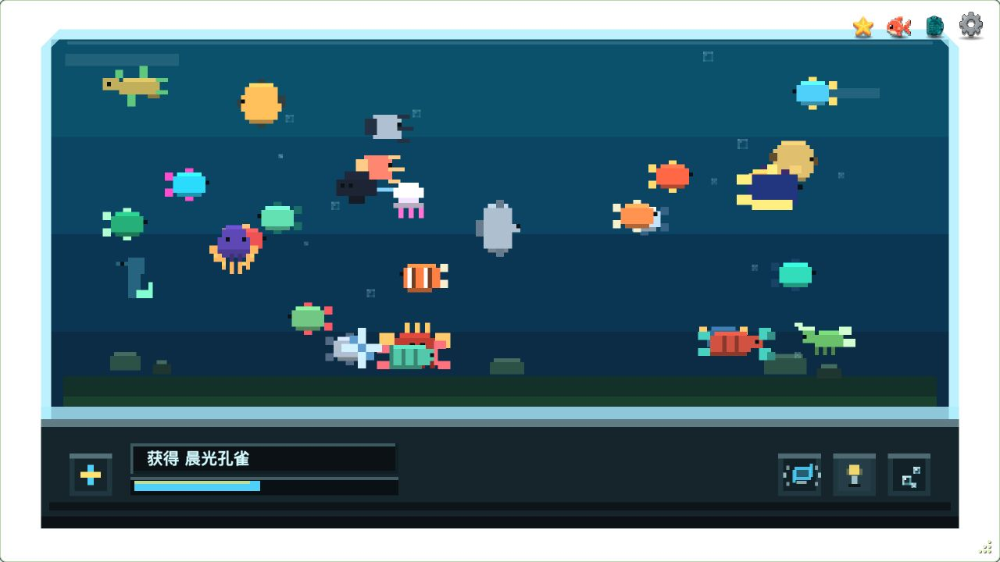

#  Key Aquarium

**A small underwater world, grown one keystroke at a time.**

English · [简体中文](README.zh-CN.md)

Key Aquarium is a pixel aquarium for your desktop. Keep it beside your work and let everyday typing bring new creatures into the tank. Discover species, earn achievements, or take a moment to make some bubbles.



*Shown with a sample collection.*

Built with Vue 3, TypeScript, PixiJS, and Tauri 2. The desktop app currently targets **macOS**, and its interface is in Simplified Chinese.

## Download

**[Download for macOS · Apple Silicon & Intel](https://github.com/zJaming/key-aquarium/releases/latest/download/Key-Aquarium-macOS-universal.dmg)**

Open the `.dmg`, drag **Key Aquarium.app** to **Applications**, and launch it. Grant the [Accessibility permission](#permissions--privacy) to enable global key detection.

The app uses ad-hoc signing and has not been notarized by Apple. macOS may block the first launch; consult [Apple's guide to opening apps safely](https://support.apple.com/en-us/102445) before deciding whether to allow it.

See [all releases](https://github.com/zJaming/key-aquarium/releases) for version notes and SHA-256 checksums. Updates are installed manually.

Windows and Linux global keyboard monitoring are not implemented yet.

## How it works

1. Type as usual. Each key press advances the current aquarium cycle.
2. When the cycle completes, a creature joins your collection automatically.
3. A new cycle begins, with a different progress target depending on its rarity.

A cycle can yield a species you already own.

The **+** button on the tank also advances progress. These clicks are tracked separately from keyboard activity.

### Meet the residents

Discover **169 species** in four rarity tiers: Common, Rare, Curio, and Legendary. The collection includes fish, seahorses, jellyfish, crabs, and other aquatic creatures. Open the gallery to see what you have found and what remains to discover.

### Make it your own

- Unlock bubble, lighting, and shake controls as your collection grows.
- Earn achievements through typing, collecting species, and interacting with the tank.
- Check today's key count, lifetime activity, and your most-used keys in the status panel.
- Drag or resize the transparent window, keep it on top, or hide and restore it from the system tray.
- Use Settings to adjust visual feedback and switch to a less crowded tank.

Move the pointer over the app to reveal its toolbar. The achievement entry appears after your first achievement unlocks.

### Keep your progress

The desktop app saves progress locally. Settings provides JSON import and export for backups or transfers. You can also clear progress from Settings: this resets the collection, key statistics, and achievements while keeping your settings and window preferences.

## Permissions & privacy

On macOS, global key detection requires **Accessibility** permission. Grant access in **System Settings → Privacy & Security → Accessibility**. The in-app permission notice can open this settings page for you.

Key Aquarium records key identifiers, counts, and activity timestamps to drive progress and statistics. It does not save the text you type. No account is required.

## Development

### Requirements

- Node.js 22.13+ in the 22.x line, or Node.js 24+.
- pnpm 9, matching the repository's pinned package manager.
- Rust 1.88+.
- macOS with Xcode Command Line Tools for desktop development.

### Run the desktop app

```sh
git clone https://github.com/zJaming/key-aquarium.git
cd key-aquarium
pnpm install --frozen-lockfile
pnpm tauri dev
```

Grant the macOS permission described above to count keys while working in other apps.

### Preview in a browser

```sh
pnpm dev
```

Open the local URL printed in the terminal. The browser preview responds only to keys pressed within the page. It has no system tray or native save storage, so progress resets on reload; export JSON before reloading if you want to keep it.

Development mode includes buttons for previewing species and achievements. They are hidden in production builds.

### Check and build

| Command | Purpose |
| --- | --- |
| `pnpm typecheck` | Check TypeScript and Vue types |
| `pnpm test` | Run unit tests |
| `pnpm build` | Check types and build the frontend |
| `pnpm tauri build` | Build the macOS desktop bundles |

Frontend files are written to `dist/`; desktop bundles are written to `src-tauri/target/release/bundle/`.

## License

[MIT](LICENSE) © 2026 Jaming.
