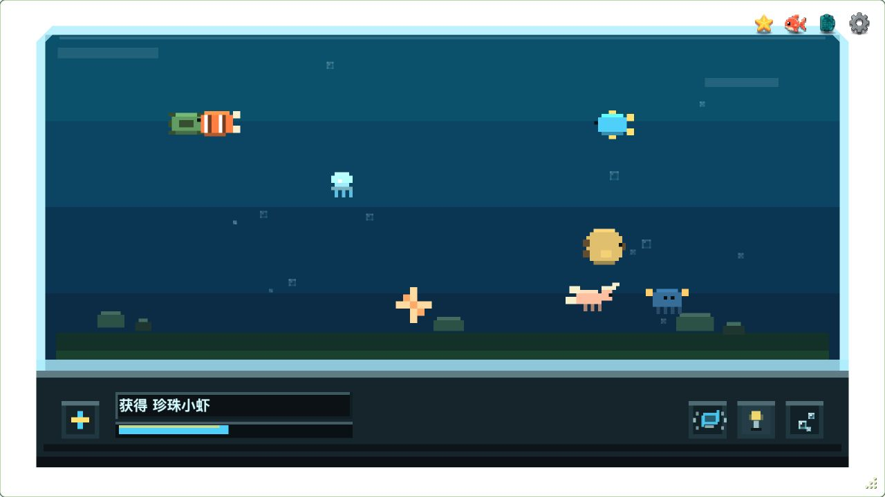

#  Key Aquarium

**每敲一次键盘，让桌面上的海底世界生长一点。**

[English](README.md) · 简体中文

Key Aquarium 是一个像素风桌面水族箱。把它放在工作区一角，日常打字就能迎来新的水族箱居民。慢慢收集物种、解锁成就，或在忙碌间隙点几个气泡。



_画面使用演示收藏数据。_

使用 Vue 3、TypeScript、PixiJS 和 Tauri 2 构建。目前桌面端主要面向 **macOS**，应用支持简体中文与英文，可在设置中切换。

## 下载

**[下载 macOS 安装包 · 支持 Apple Silicon 与 Intel](https://github.com/zJaming/key-aquarium/releases/latest/download/Key-Aquarium-macOS-universal.dmg)**

打开 `.dmg`，将 **Key Aquarium.app** 拖入 **Applications（应用程序）** 后启动。

> **首次启动：** 应用尚未经 Apple 公证。若被 macOS 拦截，确认安装包来源可信后，前往「**系统设置 → 隐私与安全性**」，点击「**仍要打开**」，再确认「**打开**」。

按照[权限与隐私](#权限与隐私)中的说明授予辅助功能权限，即可在使用其他应用时累计按键。

[所有版本](https://github.com/zJaming/key-aquarium/releases)中提供更新说明和 SHA-256 校验文件，从 v0.1.2 起，可以在设置中检查更新、下载并安装，再自行选择重启。v0.1.0 和 v0.1.1 用户需先手动安装一次新版 `.dmg`，才能使用此功能。

Windows 和 Linux 暂未实现全局键盘监听。

## 玩法

1. 正常打字，每次按键都会推进当前养成周期。
2. 进度满后，自动获得一位水族箱居民，加入收藏。
3. 随即进入下一轮，等待下一位新朋友。

每轮也可能获得已经收集过的物种。

水族箱底座的 **+** 按钮也能推进养成进度，点击次数与键盘按键次数分别统计。

### 认识水族箱居民

日常打字会逐渐迎来形态各异的水族箱居民，打开图鉴，可以回顾已经遇见的面孔。还有哪些新朋友，就留给你慢慢发现。

### 按自己的节奏养鱼

- 随着收藏增加，逐步解锁气泡、开关灯和震动互动。
- 通过打字、收集物种和水族箱互动获得成就。
- 在状态面板查看今日按键、累计按键和常用键排行。
- 拖动、缩放或置顶透明窗口，也可以通过系统托盘隐藏和恢复。
- 在设置中调整按键反馈，或切换为少量物种显示模式。

鼠标移入应用后显示工具栏；解锁首个成就后会出现成就入口。

### 保存你的收藏

桌面版会在本机保存进度，设置中提供 JSON 导入和导出，方便备份或迁移。也可以在设置中清空数据：这会重置物种收藏、按键统计和成就，并保留设置、窗口位置及置顶偏好。

## 权限与隐私

macOS 全局按键统计需要**辅助功能**权限。请在「**系统设置 → 隐私与安全性 → 辅助功能**」中授权；也可以通过应用内的权限提示打开对应设置页面。

应用记录键位标识、次数和活动时间，用于养成进度与统计，不保存输入的文本，无需注册账号。

## 开发

### 环境要求

- Node.js 22.13+（22.x 系列）或 Node.js 24+。
- pnpm 9，与仓库固定的包管理器版本保持一致。
- Rust 1.88+。
- 桌面开发需要 macOS 和 Xcode Command Line Tools。

### 运行桌面版

```sh
git clone https://github.com/zJaming/key-aquarium.git
cd key-aquarium
pnpm install --frozen-lockfile
pnpm tauri dev
```

按照上方说明授予 macOS 权限，即可在使用其他应用时累计按键。

### 浏览器预览

```sh
pnpm dev
```

打开终端输出的本地地址。浏览器预览只响应页面内的按键，没有系统托盘和原生存档存储，刷新页面后进度会重置；如需保留，请先导出 JSON。

开发模式会显示用于预览物种和成就的测试按钮，正式构建会隐藏这些按钮。

### 检查与构建

| 命令               | 用途                        |
| ------------------ | --------------------------- |
| `pnpm typecheck`   | 检查 TypeScript 和 Vue 类型 |
| `pnpm test`        | 运行单元测试                |
| `pnpm build`       | 检查类型并构建前端          |
| `pnpm tauri build` | 构建 macOS 桌面安装包       |

前端构建产物位于 `dist/`，桌面构建产物位于 `src-tauri/target/release/bundle/`。

### 签名更新包

更新包需要签名密钥。发行自己的版本时，运行 `pnpm tauri signer generate -w /仓库外的路径/updater.key`，并将生成的公钥填入 `src-tauri/tauri.conf.json` 的 `plugins.updater.pubkey`。私钥应保存在仓库外并做好备份。

```sh
TAURI_SIGNING_PRIVATE_KEY=/仓库外的路径/updater.key \
TAURI_SIGNING_PRIVATE_KEY_PASSWORD='' pnpm tauri build
```

构建通用包前需安装 `aarch64-apple-darwin` 和 `x86_64-apple-darwin` 两个 Rust target，并在构建命令后加上 `--target universal-apple-darwin`。

发布更新时，将通用更新包命名为 `Key-Aquarium-macOS-universal.app.tar.gz`，签名文件使用相同名称再加 `.sig`。运行 `pnpm release:manifest /发布产物目录`，把更新包、签名和生成的 `latest.json` 上传到对应的 GitHub Release。两个 macOS 架构使用同一个通用包；Fork 发行还需修改更新源地址，以及 `scripts/create-update-manifest.mjs` 中的仓库地址。

## 许可证

[MIT](LICENSE) © 2026 Jaming。
